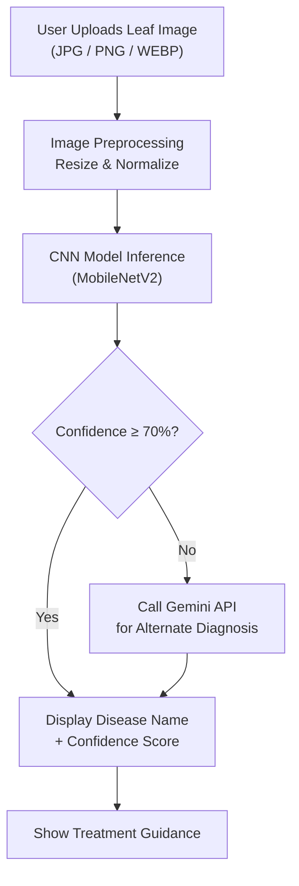

# 🌿 Plant Disease Detection System


A web-based plant disease identification system built using a Convolutional Neural Network (CNN). Users upload a leaf image and instantly receive a diagnosis, including the disease name, confidence score, and treatment guidance.

This project was developed as a BCA Major Project at Maharana Pratap College of Professional Studies, Session 2025–26.

**Live Demo:** https://plant-disease-identification-tg1r.onrender.com/

---

## Table of Contents

- [Overview](#overview)
- [Features](#features)
- [How It Works](#how-it-works)
- [Tech Stack](#tech-stack)
- [Getting Started](#getting-started)
- [Project Structure](#project-structure)
- [Model Details](#model-details)
- [Design Decisions](#design-decisions)
- [Team & Acknowledgements](#team--acknowledgements)
- [Future Improvements](#future-improvements)
- [License](#license)

---

## Overview

Agriculture plays a vital role in the economy, and early detection of plant diseases can prevent major crop losses. This project makes disease detection easier and faster using CNN-based image classification.

The system:

- Accepts leaf images through a web interface.
- Preprocesses images for the model (resize and normalize).
- Uses a trained MobileNetV2 model to predict the disease type.
- Displays prediction results and treatment guidance.
- Falls back to the Gemini API when model confidence is low.

---

## Features

- **Image Upload:** Supports JPG, PNG, and WEBP formats.
- **CNN-based Prediction:** Uses a trained MobileNetV2 model across 38 plant disease categories.
- **Confidence Scores:** Shows the top probable diagnoses with confidence percentages.
- **LLM Fallback (Gemini API):** If model confidence is below 70%, the image is routed to the Gemini API for an alternate diagnosis.
- **Responsive UI:** Clean, user-friendly interface built with HTML, CSS, and vanilla JavaScript.
- **Treatment Guidance:** Suggests basic treatment steps for the identified disease.

---

## How It Works



---

## Tech Stack

| Layer              | Technology                         |
| ------------------ | ---------------------------------- |
| Language           | Python 3.8+                        |
| ML Framework       | TensorFlow, Keras                  |
| Model Architecture | MobileNetV2 (Transfer Learning)    |
| Backend            | Flask, Flask-CORS                  |
| Frontend           | HTML5, CSS3, JavaScript            |
| Image Processing   | NumPy, Pillow                      |
| Data Handling      | JSON                               |
| Training Environment | Google Colab / Local Python      |

---

## Getting Started

### Prerequisites

- Python 3.8+
- pip
- TensorFlow, Flask, Flask-CORS, NumPy, Pillow
- A Gemini API key (only needed for the low-confidence fallback)
- A GPU for training (Google Colab offers a free one)

### Installation

1. **Clone the repository**

   ```bash
   git clone https://github.com/ChaitanyMishra/plant_disease_identification.git
   cd plant_disease_identification
   ```

2. **(Optional) Create a virtual environment**

   ```bash
   python -m venv venv
   source venv/bin/activate      # Windows: venv\Scripts\activate
   ```

3. **Install dependencies**

   ```bash
   pip install -r requirements.txt
   ```

   Or install manually:

   ```bash
   pip install tensorflow flask flask-cors numpy pillow
   ```

### Training the Model

1. **Open Google Colab:** create a new notebook and set the runtime type to **GPU**.
2. **Upload the training script:** copy the contents of `train.py` into the notebook.
3. **Run the notebook:** the model trains on the PlantVillage dataset and generates the output files.
4. **Download the model files** and place them inside the `model/` folder:
   - `plant_disease_model.h5`
   - `class_names.json`

### Running the App

From the project directory:

```bash
python app.py
```

Then open your browser at **http://localhost:5000**.

---

## Project Structure

```text
plant_disease_identification/
├── train.py                     # CNN model training script
├── app.py                       # Flask backend server
├── requirements.txt             # Python dependencies
├── templates/
│   └── index.html               # Frontend UI
├── model/
│   ├── plant_disease_model.h5   # Trained CNN model
│   └── class_names.json         # Disease class labels
├── static/                      # Optional CSS/JS assets
│   └── style.css
└── README.md                    # Project documentation
```

---

## Model Details

- **Model Type:** Convolutional Neural Network (CNN)
- **Base Architecture:** MobileNetV2 (Transfer Learning)
- **Dataset:** PlantVillage
- **Classes:** 38 plant disease categories (Tomato, Potato, Apple, Corn, Grape, Pepper, Strawberry, and more)

The model is trained on labeled leaf images and learns patterns such as:

- Color changes
- Texture variations
- Spots and lesions
- Leaf damage patterns

---

## Design Decisions

### Why MobileNetV2?

MobileNetV2 is a lightweight, pre-trained CNN optimized for mobile and edge devices. It gives high accuracy while keeping the model small (a few megabytes), so inference runs fast on a standard CPU without a dedicated GPU.

### Why Transfer Learning?

Training a CNN from scratch needs millions of images and heavy compute. With transfer learning, we reuse features MobileNetV2 already learned from ImageNet (about 1.4 million images) and fine-tune only the top layers for plant disease classification. This gives high accuracy with far less data and training time.

### Why the Gemini API Fallback?

A CNN is only as good as its training data. Blurry images, rare plant species, or unusual angles can leave the model uncertain. By checking the confidence score, low-confidence predictions (below 70%) are routed to a generative AI model (Gemini) for a secondary diagnosis and explanation.

---

## Team & Acknowledgements

| Name              | Roll No.     | Role      |
| ----------------- | ------------ | --------- |
| Chaitany Mishra   | 23071001635  | Team Lead |
| Bhuyash Pathak    | 23071001633  | Member    |
| Aryan Gupta       | 23071001601  | Member    |
| Asmit Singh       | 23071001610  | Member    |

**Project Guide:** Mr. Shiv Bahadur Singh
**Course:** BCA, Maharana Pratap College of Professional Studies
**Session:** 2025–26

---

## Future Improvements

- [x] Add more plant species and disease classes.
- [x] Improve model accuracy using data augmentation.
- [x] Enhance the frontend UI for mobile responsiveness.
- [x] Add a result history feature using a database (PostgreSQL).
- [x] Deploy the app online using Render.
- [x] Add disease severity analysis (e.g., early vs. late stage).

---

## License

This project is currently intended for academic and educational use.
